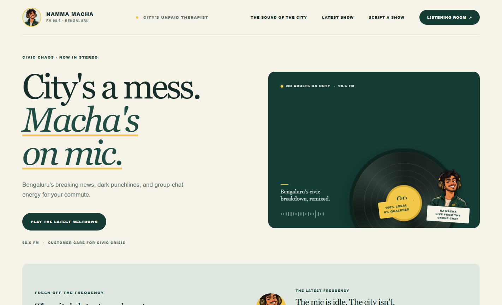
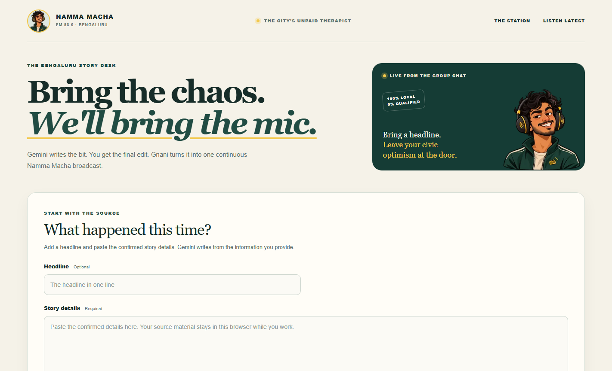
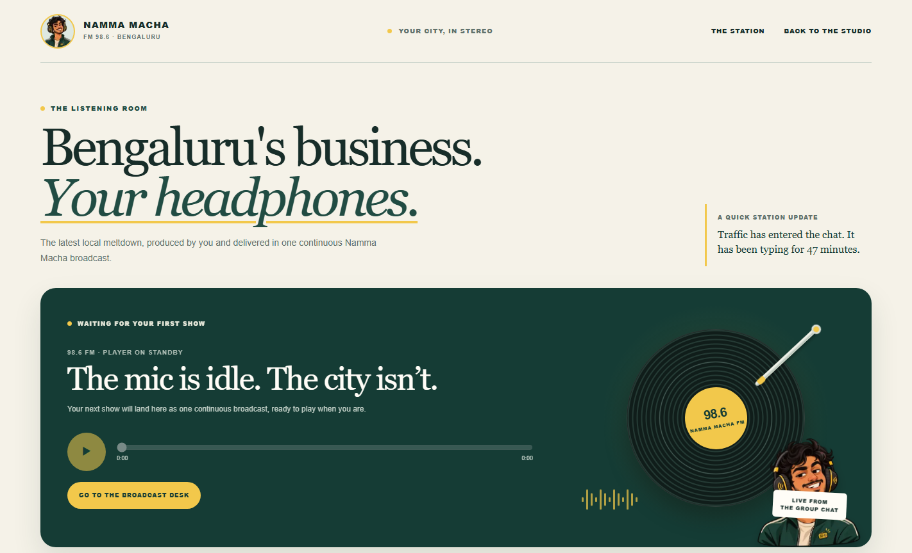

<div align="center">
  
  <h1>Namma Macha FM 98.6</h1>
  <p><strong>Bengaluru's civic chaos, remixed into one uninterrupted radio show.</strong></p>
  <p>Breaking news. Dark punchlines. Group-chat energy. Full Bengaluru flavour.</p>
</div>

<p align="center">
  
</p>

## The USP

Most script generators stop at text. Namma Macha turns a local story into a complete Bengaluru FM bit: Gemini drafts the script, you get to review it, Gnani Timbre voices it, and the intro and iconic “What are you people doing?” reaction clip are woven into one continuous broadcast.

The result is made for the commute: a little civic despair, a lot of personality, and jokes aimed at the chaos and the people responsible for it.

## The three rooms

### The station

The landing page sets the frequency and plays the latest saved show.


### The story desk

Give the studio a headline and the story details. Gemini drafts from the information you paste; you can review and edit the script before asking Gnani to narrate it.



### The listening room

The finished show is one WAV in a continuous sequence. The vinyl spins while playback is active, and the latest show is saved in this browser for replay.



## How a show comes together

1. Paste the confirmed story details and an optional headline.
2. Gemini writes an original, source-grounded RJ Macha script with Bengaluru slang and performance cues.
3. Review or edit the script. Keep the `[[QUESTION_CLIP]]` marker exactly once to place the reaction clip.
4. Gnani Timbre v3 voices the two narration sections.
5. The app joins the intro, first narration, reaction clip, and second narration into one WAV, then opens the listening room.

The story desk uses the details you provide; article links are not supported in the form.

## Run it locally

### Requirements

- Node.js 22 or newer
- A Gemini API key
- A Gnani API key with Timbre access

### Setup

```bash
git clone https://github.com/dhivenxd/namma-macha-fm.git
cd namma-macha-fm
npm install
```

Copy `.env.example` to `.env.local`, then add your keys to `.env.local`:

```env
GEMINI_API_KEY=your_gemini_key
GNANI_API_KEY=your_gnani_key
```

On Windows PowerShell, copy the file with:

```powershell
Copy-Item .env.example .env.local
```

Start the development server:

```bash
npm run dev
```

Open [http://localhost:3000](http://localhost:3000). The story desk is at `/broadcast`; the listening room is at `/listen`.

## Built with

- Next.js App Router, React, and TypeScript
- Gemini Interactions API for script writing
- Gnani Timbre v3 for speech synthesis
- Web Audio APIs for assembling a continuous WAV in the browser
- IndexedDB for saving the latest show locally

## Keep your keys private

API keys stay in the server-side `.env.local` file. It is ignored by Git. Never put a key in a `NEXT_PUBLIC_` variable, commit your `.env.local`, or paste a key into a screenshot or issue. The committed `.env.example` contains variable names only.

Generated shows are stored in the current browser's IndexedDB; they do not sync between devices. Review AI-written scripts before generating audio.

## Quality checks

```bash
npm run lint
npx tsc --noEmit
```
